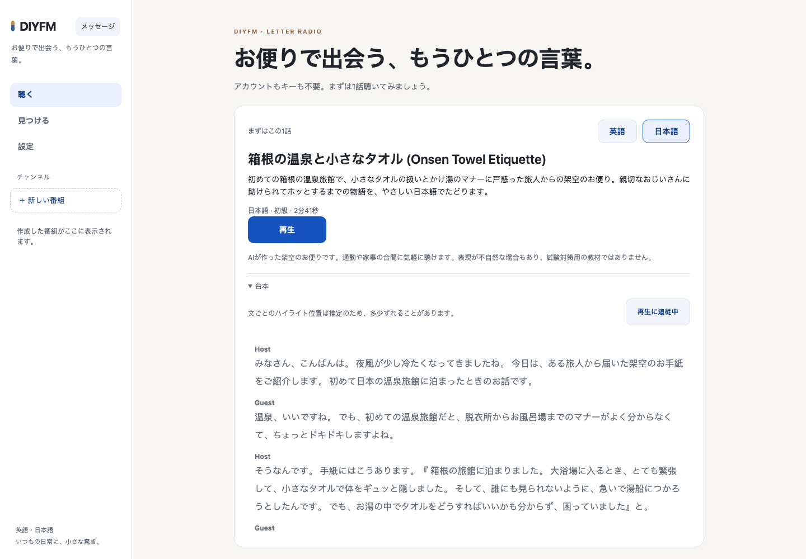
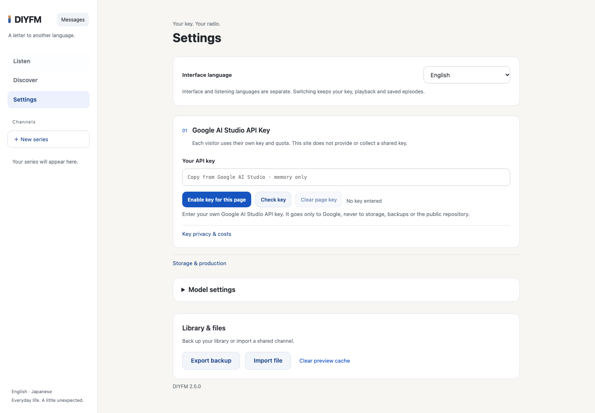
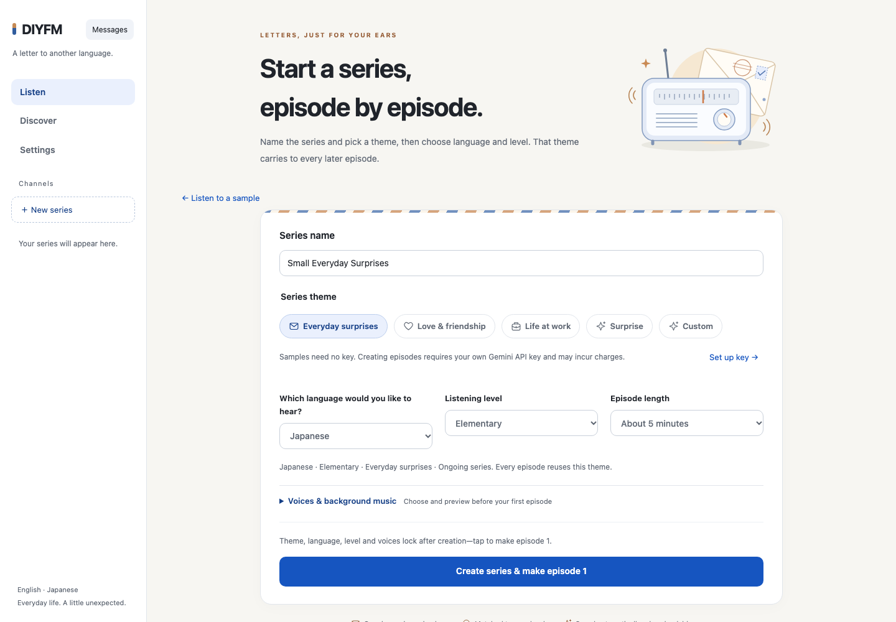
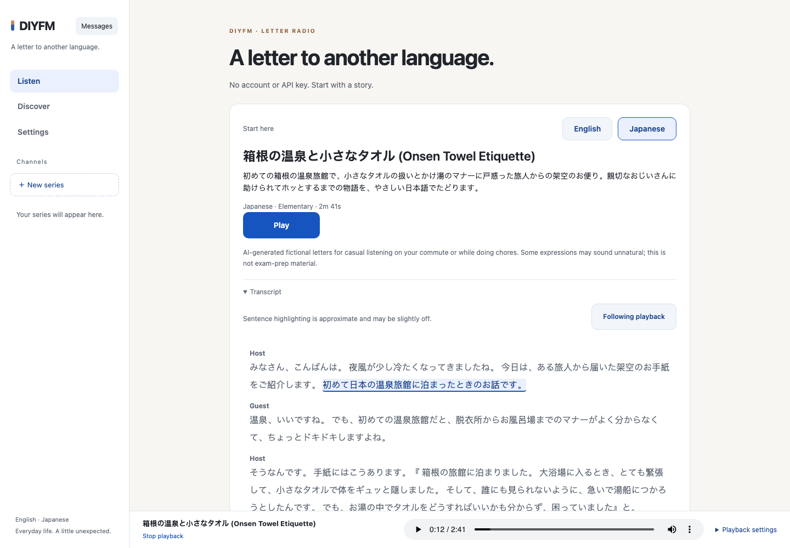
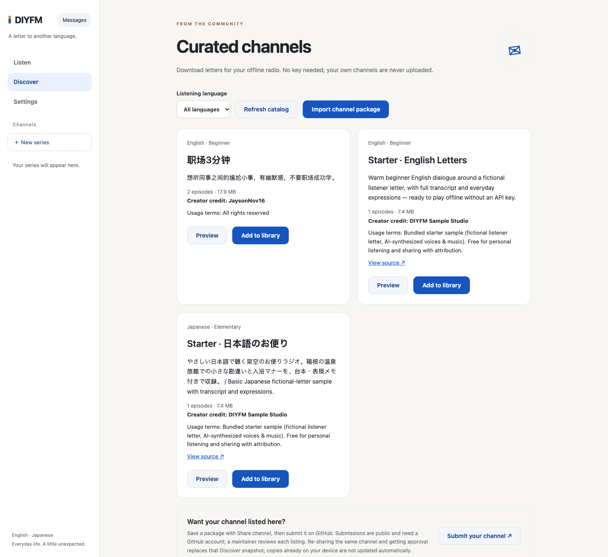

# DIYFM · お便り言語ラジオ

[English](README.md) · [日本語](README.ja.md) · [中文](README.zh-CN.md)

**お便りで出会う、もうひとつの言葉。** 二人のホストが架空のお便りを読み、日常の小さな驚きや友情、勘違いについて話します。**英語・日本語**を選び、通勤や家事の合間に気軽に聴けます。好きなテーマで自分の番組を作ることもできます。

**[今すぐ聴く：アカウント・キー不要](https://jayson-sheyue.github.io/DIYFM/) · [Mac / Android版をダウンロード](https://github.com/jayson-sheyue/DIYFM/releases/latest)**



*画像は2.5.0 Web版の公開サンプルです。ホームは日本語、以降の操作例は初期設定の英語UIで表示しています。設定で英語・日本語・中国語に切り替えられ、聴く言語は別に選びます。[更新履歴](https://github.com/jayson-sheyue/DIYFM/releases)。*

**2.6.1** ではZIPから取り込んだ番組の続きが作れない問題を修正しました。制作テーマがない場合は「新しいエピソード」から一度だけ番組設定を補えます。保存にキーやモデル呼び出しは不要で、既存の音声と出典は保持されます。完全なバックアップは保存済みの固定設定を引き継ぎます。

**2.6.0** ではBGMに「気分・シーンを指定」を追加しました。「失恋、雨の夜」「壮大な叙事詩」などの短い言葉を、選択中のテキストモデルが器楽BGMの指示に整え、Lyriaで生成します。初回はテキストと音楽の両モデルを使い、保存済みの試聴には呼び出しがありません。作り直しは整理済みの指示を再利用します。入力は240文字までで、番組開設後は固定です。

**2.5.2** ではメッセージにプロバイダーの元のエラー本文とHTTPステータスを表示します。2.5.1では新TTSによる演技指示の読み上げを修正し、Web・macOS・AndroidにモデルプリセットとカスタムID入力を追加しました。

## まずは聴いてみる

| やりたいこと | 最初の操作 | APIキー |
| --- | --- | --- |
| 完成した番組を試す | ホーム → 英語／日本語 → **再生** | 不要 |
| おすすめ番組をライブラリに追加 | **見つける → ライブラリに追加** | 不要 |
| 自分のテーマで制作 | **設定**でキーを有効化 → **新しい番組** | 自分のGeminiキーが必要。料金が発生する場合あり |

1. [DIYFMを開く](https://jayson-sheyue.github.io/DIYFM/)、または下記のクライアントをインストールします。
2. ホームで **英語** または **日本語** を選び、**再生**を押します。登録や事前設定は必要ありません。
3. 台本は開いた状態です。下部プレーヤーの **再生設定** で速度を変えられ、再生に合わせて推定位置の文がハイライトされます。
4. サンプルをライブラリに残すには **見つける** で対象を選び、**ライブラリに追加**を押します。次回は前回選んだ保存済みチャンネルを復元します。

ホームは選んだ言語のサンプルだけを読み込みます。Webで初めて聴くときは通信が必要です。Mac・Androidはサンプルを内蔵し、オフラインで試聴できます。保存済み音声もアプリを開ける環境でオフライン再生できます。クイズ、マイク、録音、シャドーイング、連続学習の記録は不要です。

## 自分の番組を作る

### 1. キーを有効にする



1. [Google AI Studio](https://aistudio.google.com/apikey)で自分のGemini APIキーを取得します。
2. **設定 → 自分のAPIキー**に貼り付け、**このページでキーを有効化**を押します。入力欄は空になり、有効かどうかだけを表示します。
3. **キーを確認**は任意です。選択したテキストモデルの情報を読むだけで、音声・BGM・すべての生成権限を確認する機能ではありません。
4. **聴く → 新しい番組**、またはホームの **自分の番組を作る** に進みます。設定から戻っても入力途中の下書きは残ります。

**サンプル再生にモデル呼び出しはありません。制作、初回の声の試聴、音楽生成は自分のキーを使い、料金が発生する場合があります。** キーはメモリ内だけに保持し、再読み込みや終了で消えます。保存済み番組は残り、再生のためにキーを入れ直す必要はありません。[キーとデータの説明](docs/security.md)。

### 2. 番組名とテーマを決める



1. **番組名**を入力します。例：`週末の小さなできごと`。
2. 日常、恋愛・友情、職場、おまかせ、カスタムからテーマを選びます。カスタムは聴きたい話の雰囲気を書くだけです。例えば：
   > ルームメイト同士の小さな勘違いを、やさしい日本語で、温かく軽い雰囲気で話してほしい。
3. **聴く言語・レベル・長さ**を選びます。希望を書いた言語ではなく、言語の選択欄が優先されます。初期値は初級・約5分で、約3／5／10／15分を選べます。
4. 初回制作前に **声とBGM** を開き、二人の声や音楽を選べます。BGMなしも選択できます。
5. **番組を開設して第1話を作る**を押し、**メッセージ**で進捗を確認します。アプリ内の画面切り替えは可能ですが、Webページは閉じず、Androidでは制作中に前面表示を維持してください。
6. 完成したら **再生**。次回以降は **新しい番組を作る** で同じテーマを使い、毎回シナリオを入力する必要はありません。

**開設後は設定が固定されます。** テーマ、言語、レベル、長さ、声、BGMを変えたい場合は別の番組を作ります。図の入力内容は操作例の下書きで、画像のために有料生成は行っていません。

## 台本を見ながら聴く



- 保存済みの番組は **台本と番組の情報** を開くと、台本・表現・利用できる参考資料を確認できます。ホームの台本は最初から開いています。
- **文のハイライト位置は推定です。** 新しい録音は各音声ターンの実測時間を使い、ターン内の文を推定します。古い番組とサンプルは全体の長さから推定するため、ずれる場合があります。
- 手動スクロールや文字選択でスクロール追従が止まります。**再生中の文へ**で戻れます。一時停止中もハイライトは残り、再生位置を動かすと更新されます。
- **再生設定**で速度、**1話をリピート**、**チャンネル連続再生**を変更できます。連続再生は完成済みの一覧を順に再生し、最後から先頭へ戻ります。サンプルや声・BGMの試聴は1回だけです。
- 完成音声には生成できたBGMのミックスを含みます。MP3の保存にモデル呼び出しはありません。

AIが作った架空のお便りと合成音声による気軽なリスニング用の番組です。日本語はモデル審査と最大1回の修正を使い、各話を人手で校正する工程はありません。表現や発音が不自然な場合があり、試験対策教材や学習効果の保証としては提供していません。

## 保存・見つける・共有



| やりたいこと | 操作 | 保存されるもの |
| --- | --- | --- |
| 音声ファイルを残す | 番組 → **MP3をダウンロード** | 元のBGMミックスを含む完成音声 |
| おすすめを聴く | **見つける → プレビュー／ライブラリに追加** | キーやアカウント不要のローカルコピー |
| 選んだ完成番組を共有 | **チャンネル管理 → チャンネルを共有** | 音声・台本・公開の制作者情報を含むチャンネルZIP |
| 共有されたチャンネルを開く | **設定 → ファイルを読み込む** | ZIPをプレビューしてから端末へ追加 |
| 全体をバックアップ | **設定 → バックアップを書き出す** | 番組・音声・台本・通常設定・制作途中の成果。キーは除外 |
| 別の端末・ブラウザへ移す | バックアップを書き出し、移行先で読み込む | 既存ライブラリへ追加。自動クラウド同期なし |

公開共有には **チャンネルパッケージ** を使ってください。ライブラリ全体のバックアップには非公開の希望や制作素材が含まれることがあります。どちらにもAPIキーは含みません。保存済みのおすすめは自動更新されません。任意の **チャンネルを投稿** は公開GitHubフォームを開き、GitHubアカウントが必要です。[共有と掲載のガイド](docs/sharing.md)。

## Mac・Android版をインストール

| 版 | 始め方 | 動作条件 |
| --- | --- | --- |
| Web | 新しいブラウザで [DIYFMを開く](https://jayson-sheyue.github.io/DIYFM/) | 初回サンプル読み込みは通信が必要。開発ツールは不要 |
| Mac | [最新のUniversal DMG／ZIP](https://github.com/jayson-sheyue/DIYFM/releases/latest)から **DIYFM.app** をアプリケーションへコピーして開く | macOS 13+、Apple Silicon／Intel |
| Android | [最新APK](https://github.com/jayson-sheyue/DIYFM/releases/latest)をシステムのインストーラーで開く | Android 8+、新しいSystem WebView |

Macはアドホック署名でApple公証は未実施のため、ダウンロードしたアプリがブロックされる場合があります。Apple Siliconは実機確認済み、Intel実機は未確認です。Macは終了してから置き換え、Androidはデータを残すため上書きインストールしてください。**設定**に現在のバージョンを表示します。更新ボタンはブラウザでダウンロードを開き、自動インストールはしません。[クライアントの導入・保存・更新](docs/clients.md)。

## 表示言語・保存先・よくある質問

- **日本語UIにするには？** **Settings → Interface language → 日本語** を選びます。初回は英語で、選択は記憶されます。保存済み番組の翻訳や聴く言語の変更は行いません。
- **キーがなくても使えますか？** ホームのサンプルや「見つける」の番組を聴けます。制作や未キャッシュの声・音楽試聴にはキーが必要です。
- **キーが消えました。** 再読み込み・終了後は想定どおりです。新しく制作するときに再度有効化します。保存済み音声は再生できます。
- **制作に失敗したら？** **メッセージ**で詳細を確認して再試行します。互換性のある完成済み段階は再利用しますが、残りの呼び出しは有料になる場合があります。BGMだけ失敗した場合は声のみを残します。
- **番組はどこにありますか？** ブラウザ・端末・クライアントごとに独立しています。サイト／アプリのデータ消去やアンインストールで失われる場合があるため、移行・消去前にバックアップします。MP3だけでライブラリ全体を復元することはできません。
- **削除するには？** 各話の **···** または **チャンネル管理** から削除します。確認後は取り消せないので、必要なら先にバックアップしてください。

失敗時は **メッセージ** の該当項目を開くと、HTTPステータスとプロバイダーの元の応答本文・エラーコード・detailsを確認できます。要約や翻訳で置き換えず、応答に含まれた現在のAPIキーだけを伏せます。ネットワーク障害はブラウザーの元の例外を表示し、HTTPコードを作りません。旧版が破棄した元の応答は復元できません。BGMのみ失敗した場合も独立したメッセージを残し、音声のみの完成番組は再生できます。

### モデル設定

詳細設定は **設定 → モデル設定** にあります。最初は初期値のままで始められます。

| 用途                            | 既定のモデル                   | API                                                   |
| ------------------------------- | ------------------------------ | ----------------------------------------------------- |
| 構成・事実確認・創作・レビュー  | `gemini-3.8-flash`             | Gemini `generateContent`、確認時にGoogle Searchを使用 |
| 二人の音声と声の試聴            | `gemini-3.8-flash-tts` | Gemini Interactions、構造化音声メタデータ                    |
| 約30秒のインストゥルメンタルBGM | `lyria-3-clip-preview`         | Gemini Interactions、`store: false`                   |

テキスト・音声・音楽それぞれのプリセットを選ぶか、モデルIDを直接入力できます。プリセットは公式一覧に基づきます（確認日：2026-11-27）が、アカウントでの利用を保証しません。Previewは変更・廃止される場合があります。保存したIDは、変更するか **モデルを初期値に戻す** を選ぶまで保持されます。音声の初期値は `gemini-3.8-flash-tts` で、`gemini-3.8-flash-lite-tts` と旧 `gemini-3.1-flash-tts-preview` も選べます。新TTSでは本文は台詞のみとし、演技指示は `speech_metadata.style` に分離して24 kHz PCMを指定します。旧PreviewのIDでは従来の `generateContent` 形式を維持します。カスタム音声IDは現在のInteractions TTS仕様に対応する必要があり、通常のテキストモデルでは代用できません。この仕様変更前の試聴・失敗タスクの音声断片は再利用しません。保存済みの完成番組は保持され、自動修復されません。[公式音声ガイド](https://ai.google.dev/gemini-api/docs/speech-generation)と[移行ガイド](https://docs.cloud.google.com/gemini-enterprise-agent-platform/models/text-to-speech/migration-guide)を参照してください。

モデルIDは手入力で変更できます。利用可否はキー・地域・課金・モデルの機能によって異なり、別モデルへ自動で置き換えることはありません。旧Vertexの`lyria-002`はAI Studioの接続先では使用できません。Developer APIに対応する`lyria-3.5`などは、長さや費用が異なる場合があります。音楽の生成に失敗した場合は声のみを保存して通知します。内容や音声の失敗を完成した番組として表示することはありません。


## ローカルで静的版を動かす

新しいブラウザと、インストール・検証・ビルド用のNode.js 22以降を使用します。静的HTTPサーバーは任意です。主アプリにADC、GCPのプロジェクトID、Pythonバックエンド、共有キーのデプロイは必要ありません。

```bash
git clone https://github.com/jayson-sheyue/DIYFM.git
cd DIYFM
npm ci --ignore-scripts
npm run vendor
npm test
npm run build

# Pythonがすでに入っている場合の一例：
python3 -m http.server 5055 --directory dist
```

`http://localhost:5055/`を開きます。`index.html`をダブルクリックして`file://`で開かないでください。ES modules、IndexedDB、Workerには通常のWebオリジンが必要です。5055が使用中なら別のポートに変更してください。

### 旧Python版のライブラリ

Flask/Vertexのソースは旧版との互換性のために残しています。主アプリはそのADC生成APIを使用しません。移行で`data/`を削除したりGitに追加したりすることはありません。

既存の旧版環境では`app.py`を実行でき、トップページから`/static/index.html`へ移動します。この明示的なローカルパスに限り、旧チャンネル・台本・完成音声をブラウザのライブラリへコピーします。Googleは呼ばず、元ファイルも変更しません。先に`data/`のコピーを保管してください。読み取りに失敗しても元のライブラリは残ります。

旧版が書き出したZIPを新サイトで**バックアップを読み込む**こともできます。ADC認証情報はコピーせず、旧Vertex設定をDeveloper API設定として扱うこともありません。未完成の記録は確認できますが、バージョン間の読み込みで全中間段階を再利用できる保証はありません。

## GitHub Pagesへ公開する

`.github/workflows/pages.yml`でPRを検証し、`main`へのpush時に`dist/`をビルドして公開します。

1. 自分のGitHubアカウントにpublicリポジトリを作り、ソースをpushします。
2. **Settings → Pages → Build and deployment → Source**で**GitHub Actions**を選びます。
3. ワークフローを実行するか`main`へpushし、**Check and deploy DIYFM**の成功を待ちます。
4. `https://<account>.github.io/<repository>/`を開きます。相対パスのリソースはプロジェクトのサブパスにも対応します。

**Gemini用のリポジトリSecretは不要です。** Actionsの変数、ビルド引数、フロントエンド設定に共有キーを埋め込むと公開サイトに露出します。運営者が費用を負担するサービスには、アクセス制御と利用制限を備えた別のバックエンドが必要です。Pagesで共有キーを隠すことはできません。

## ソースの構成

```text
static/
  app.js / app.css / index.html    画面・再生・メッセージ・管理
  app-entry.mjs                   静的版の起動とローカル移行の境界
  i18n.mjs / messages.mjs          三言語の画面・言語選択・文言
  browser-api.mjs / library.mjs    タスク・IndexedDB・バックアップ・互換API
  harness.mjs / editorial.mjs      番組の規則・構成・レビュー
  gemini.mjs                      メモリ内のキーと固定Google接続先
  audio.mjs / mp3-worker.js        デコード・ミックス・WAV・MP3
  vendor/                         同梱の変換・ZIPライブラリとライセンス
scripts/build-pages.mjs            静的成果物と認証情報パターンの検査
tests/                            API・保存・メディア・競合の制御テスト
```

表現が登場しても習得したことにはなりません。学習効果、モデルの事実、発音が常に正しいことは保証しません。3・5・10・15分は構成の目標で、実際の長さは完成音声によります。検索失敗で出典を捏造せず、レビューによる修正は最大1回です。音声を分割して作り、失敗後のやり直しを減らします。

## 検証と現在の制限

```bash
npm test            # 規則・キー・保存・バックアップ・国際化・再生の競合
npm run build       # distを生成し、既知の認証情報パターンを検査
./scripts/check.sh  # 旧Python経路も検証。Python依存関係が必要
```

自動テストはGoogleの実アカウントとの連携確認を代替しません。実行環境、実際の呼び出し、未確認事項は[検証記録](docs/testing.md)にまとめています。モデルの公開状況、地域、有料枠、割り当て、ライフサイクルはGoogleによります。キー確認の成功は全モデルやSearchの利用可否を保証しません。ダウンロード、バックグラウンド動作、保存容量、メディア動作もブラウザにより異なります。

詳細な開発者向け資料の一部は現在中国語です。三言語のREADMEでは同じ導入手順、設定、セキュリティの境界、既知の制限を説明しています。

## ライセンス

DIYFM自体のソースコードは[MITライセンス](LICENSE)で公開します。第三者のコードにはそれぞれのライセンスが適用されます。同梱コードは[THIRD_PARTY.md](THIRD_PARTY.md)を参照してください。カタログのチャンネルパッケージは、それぞれの制作者情報に記載された利用条件で提供されます。
