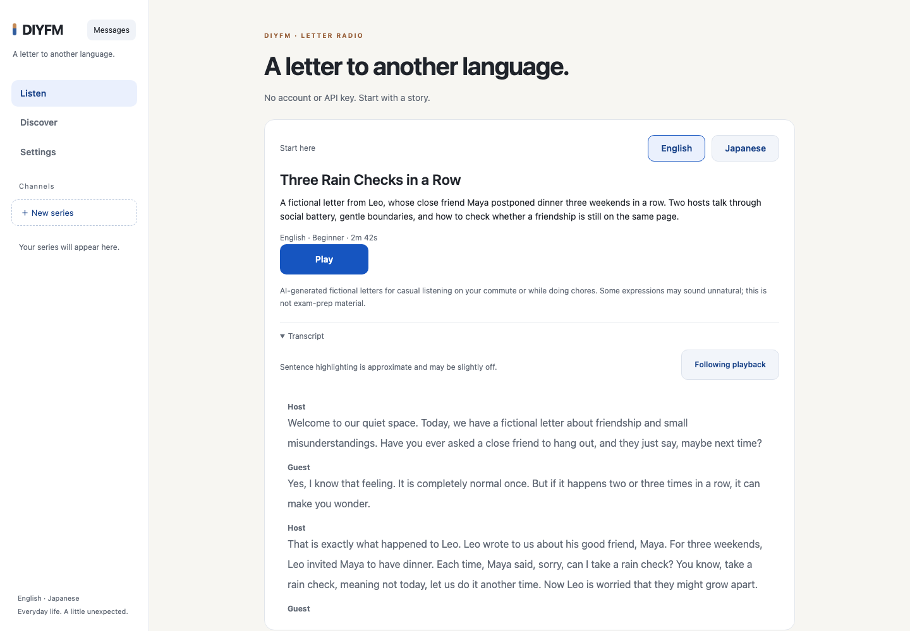
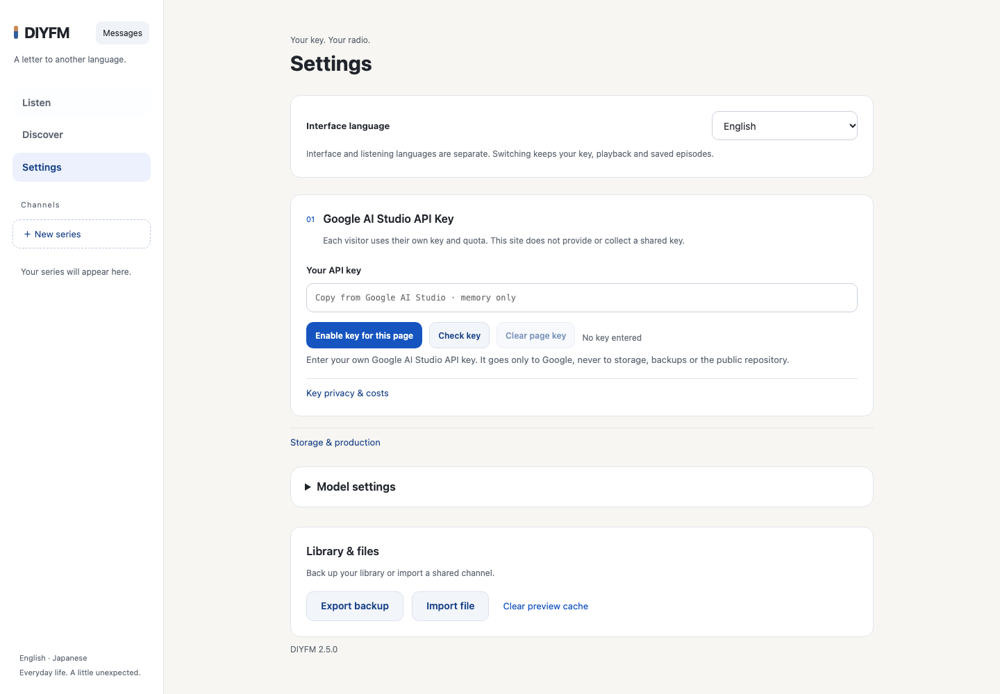
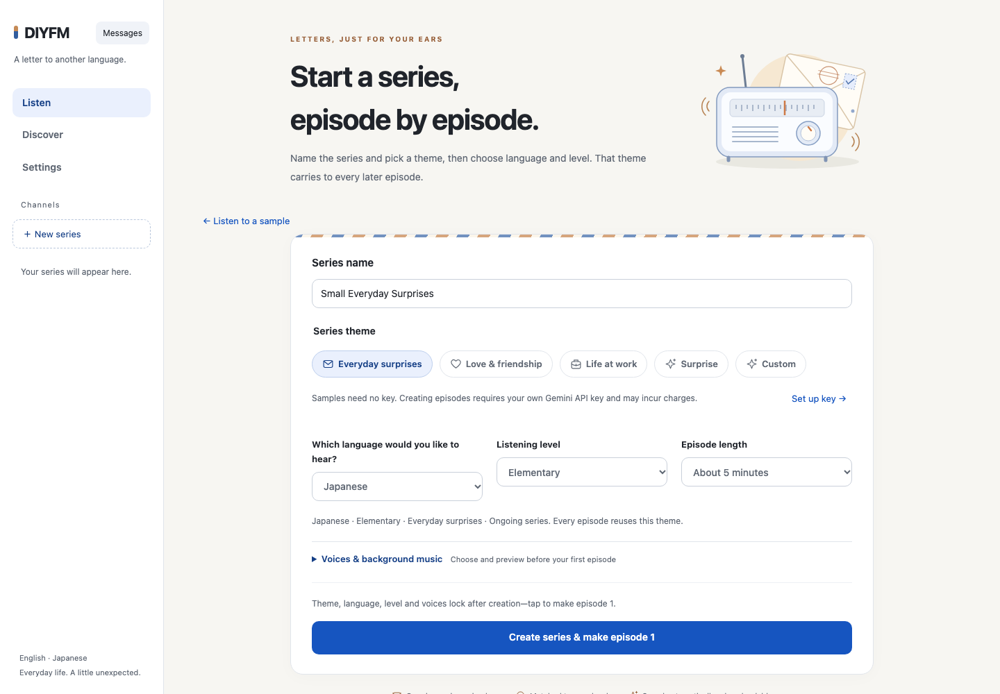
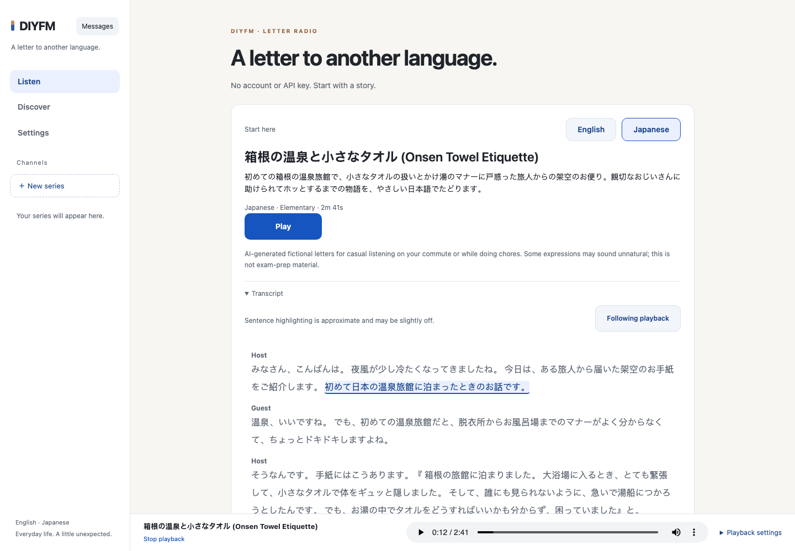
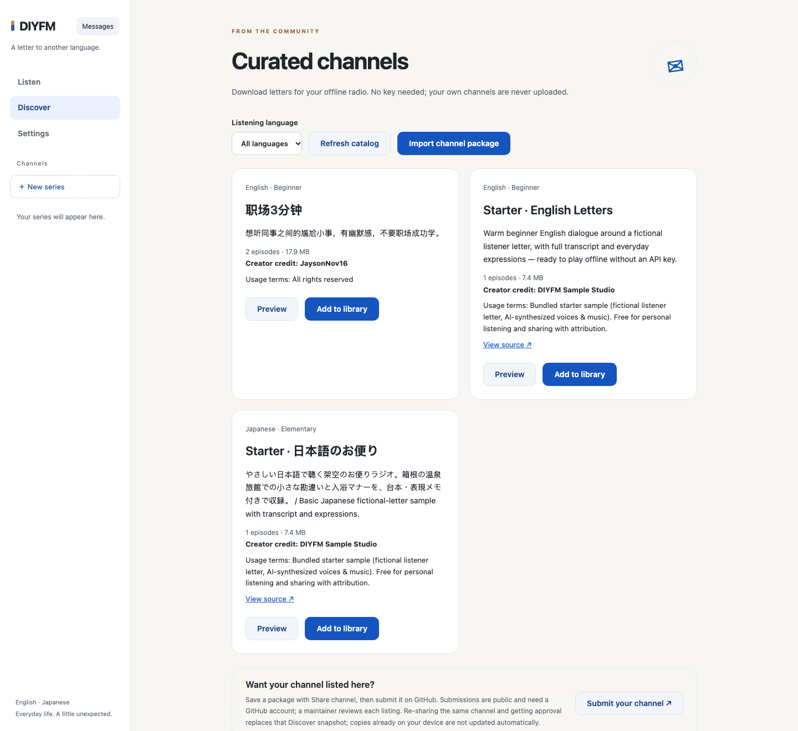

# DIYFM · Letter Radio

[English](README.md) · [日本語](README.ja.md) · [中文](README.zh-CN.md)

**Listen to a little story in another language.** Two hosts open a fictional listener letter and chat about everyday surprises, friendships and small misunderstandings. Choose **English or Japanese**, listen while commuting or doing chores, and make your own themed series when you want something new.

**[Listen now — no account or key](https://jayson-sheyue.github.io/DIYFM/) · [Download Mac / Android](https://github.com/jayson-sheyue/DIYFM/releases/latest)**



*Screenshots show the 2.5.0 web edition using public samples. The interface supports English, Japanese and Chinese; listening language is a separate choice. [Release notes](https://github.com/jayson-sheyue/DIYFM/releases).*

Version **2.6.1** fixes continuing an imported ZIP channel: if its production theme is missing, **Make next episode** opens a one-time series setup. Save the theme and preferences without a key or model call, then make a new episode. Existing episodes and credits are preserved; complete backups retain their existing locked setup.

Version **2.6.0** adds **Custom keywords or scene** under background music. Enter a few words such as “heartbreak, rainy night” or “epic grandeur”; DIYFM polishes them with your selected text model and sends the instrumental prompt to Lyria. The first custom result uses both text and music calls. Cached previews make no model call; regenerate reuses the polished prompt. Keywords (up to 240 characters) are saved with the series and remain locked after creation.

Version **2.5.2** displays original provider error bodies and HTTP status codes in Messages. Version 2.5.1 fixed spoken TTS directions and added model presets with custom IDs across Web, macOS and Android.

## Quick start

| What you want | Where to start | API key? |
| --- | --- | --- |
| Try a finished episode | Homepage → English / Japanese → **Play** | No |
| Keep a curated channel locally | **Discover → Add to library** | No |
| Make your own themed episodes | **Settings** to enable your key, then **New series** | Your own Gemini key; requests may incur charges |

1. [Open DIYFM](https://jayson-sheyue.github.io/DIYFM/) or install a client below.
2. Choose **English** or **Japanese** on the homepage and press **Play**. No registration or configuration is required.
3. Read the open transcript if you like. Use **Playback settings** in the bottom player for speed; sentence highlights follow the recording approximately.
4. Want the sample in your library? Open **Discover**, find its channel and choose **Add to library**. On later visits, DIYFM restores your last selected saved channel.

The homepage loads only the selected sample. First-time web playback needs a connection; Mac and Android bundle both samples for offline listening. Saved episodes can play offline while the application is available. There are no quizzes, microphone permissions, voice recordings or streaks to maintain.

## Make your own series

### 1. Enable your key



1. Get your own Gemini API key from [Google AI Studio](https://aistudio.google.com/apikey).
2. Open **Settings → Your API key**, paste it, and choose **Enable key for this page**. The field clears and the page shows the enabled status.
3. **Check key** is optional. It reads your selected text model's metadata; it does not test speech, music or all generation permissions.
4. Return to **Listen → New series**, or choose **Create your own series** on the homepage. Going to Settings and back keeps your draft.

**Listening to samples is free of model calls; creating episodes, first voice previews and music generation use your key and may cost money.** The key stays in memory only. Refreshing or quitting clears it, while saved episodes remain. You do not need to re-enter a key just to replay them. See [key, privacy and data boundaries](docs/security.md).

### 2. Name the series and choose its theme



1. Enter a **Series name**, such as `Small Everyday Surprises`.
2. Choose **Everyday surprises**, **Love & friendship**, **Life at work**, **Surprise**, or **Custom**. For Custom, describe the kind of stories you would enjoy, for example:
   > Funny roommate misunderstandings, warm and light, in easy Japanese.
3. Select the **listening language**, **level** and **episode length**. Writing a wish in English does not choose English listening; the language selector does. Defaults are Elementary and about 5 minutes; 3 / 5 / 10 / 15 minute targets are available.
4. Optionally open **Voices & background music** to choose both hosts and a music style, or no music, before creating the series.
5. Press **Create series & make episode 1**. Follow progress in **Messages**. Keep the page open; switching views inside the app is fine. Keep Android in the foreground during generation.
6. Once ready, press **Play**. Later, **Make a new episode** reuses the same theme without asking you to write another scenario.

**Series settings lock after creation**, including theme, language, level, duration, voices and music. Start another series for a different setup. The form screenshot is an example draft; no paid episode was generated for it.

## Listen and read along



- Open **Script & episode details** in a saved episode for its transcript, expressions and available reference sources. The homepage transcript starts open.
- **Sentence highlighting is approximate.** New episodes use measured audio-turn lengths; sentence positions within each turn are estimated. Older recordings and samples use whole-recording estimates.
- Scrolling or selecting text manually suspends scroll following. **Back to current sentence** turns following back on. Pausing keeps the highlight; seeking updates its position.
- **Playback settings** controls speed, **Repeat one** and **Play channel**. Channel playback follows the ready-episode list and wraps after the last; samples and voice/music previews play once.
- Finished episodes use the mixed audio, including BGM when available. Downloading MP3 does not call a model.

AI-generated fictional letters and synthesized voices are intended for casual listening. Japanese uses model review and at most one correction, without per-episode human proofreading. Some expressions or pronunciation may be off; this is not an exam-prep textbook or a guarantee of learning progress.

## Save, discover and share



| Task | Action | Result |
| --- | --- | --- |
| Keep an audio file | Episode → **Download MP3** | Finished audio, including its existing BGM mix |
| Listen to a curated channel | **Discover → Preview**, then **Add to library** | Local copy, no key or account needed |
| Share selected finished episodes | **Channel options → Share channel** | A channel ZIP with transcripts, audio and public credits |
| Open a shared channel | **Settings → Import file** | Preview the ZIP, then confirm adding it locally |
| Back up the whole library | **Settings → Export backup** | Channels, audio, scripts, ordinary settings and resumable work; no key |
| Move to another browser or device | Export a backup, then import it there | Merges with the destination library; no automatic cloud sync |

Use a **channel package** for public sharing: a whole-library backup can contain private wishes and production material. Neither file exports your API key. Discover snapshots already on your device do not auto-update. Optional **Submit your channel** opens a public GitHub form and requires a GitHub account. [Sharing, credits and catalog guide](docs/sharing.md).

## Install on Mac or Android

| Edition | Get started | Requirements |
| --- | --- | --- |
| Web | [Open DIYFM](https://jayson-sheyue.github.io/DIYFM/) in a modern browser | Connection for the first sample load; no developer tools |
| Mac | [Download the latest Universal DMG or ZIP](https://github.com/jayson-sheyue/DIYFM/releases/latest), copy **DIYFM.app** to Applications and open it | macOS 13+, Apple Silicon or Intel |
| Android | [Download the latest APK](https://github.com/jayson-sheyue/DIYFM/releases/latest) and install it using the system installer | Android 8+ and a recent System WebView |

The Mac build is ad-hoc signed, without Apple notarization; macOS may block downloaded copies. Apple Silicon is tested, while physical Intel hardware is not. Update Mac while the app is closed and install Android over the previous version to preserve data. **Settings** displays the version; the clients' update button opens a browser download and does not install automatically. [Client setup, storage and update guide](docs/clients.md).

## Language, storage and common questions

- **Change the interface:** **Settings → Interface language → English / 日本語 / 中文**. First launch is English; your choice is remembered. This does not translate saved episodes or change the listening language.
- **“I don't have a key.”** Use the homepage samples or Discover. A key is needed for production and uncached voice/music previews.
- **“My key disappeared.”** This is expected after refreshing or quitting. Re-enable it for new production; saved audio remains playable.
- **“Production failed.”** Open **Messages** and expand the failed item to see the HTTP status and original provider response, including error codes and details. Responses are not summarized or translated; an echoed active API key is redacted. Network failures show the original browser exception without an invented HTTP code. Original responses discarded by older versions cannot be recovered. Failed background music has its own message while the voice-only episode remains playable. Retry when appropriate. Compatible completed stages are reused where possible; remaining calls may incur charges. If music alone fails, DIYFM keeps the voice-only episode.
- **“Where are my episodes?”** Each browser, device and client has its own local library. Clearing site/app data or uninstalling can remove it. Back up before moving or clearing data. MP3 files alone cannot restore the whole library.
- **“Can I delete something?”** Use an episode's **···** menu for that episode, or **Channel options** for the whole channel. Deletion asks for confirmation and cannot be undone; export a backup first if needed.

### Models

Open **Settings → Model settings** for these advanced options. The defaults are enough to get started.

| Function                                       | Default model                  | API                                                      |
| ---------------------------------------------- | ------------------------------ | -------------------------------------------------------- |
| Planning, verification, writing and review     | `gemini-3.8-flash`             | Gemini `generateContent`; Google Search for verification |
| Two-host speech and voice previews             | `gemini-3.8-flash-tts` | Gemini Interactions, structured speech metadata               |
| Approximately 30 seconds of instrumental music | `lyria-3-clip-preview`         | Gemini Interactions with `store: false`                  |

Choose a preset for text, speech or music, or type a custom model ID in the editable field. Presets are catalog suggestions (checked 2026-11-27), not a guarantee of account access; Preview models can change or retire. Saved IDs are preserved until you change them or choose **Restore default models**. The default speech model is `gemini-3.8-flash-tts`, with `gemini-3.8-flash-lite-tts` and the legacy `gemini-3.1-flash-tts-preview` also listed. New TTS requests send only the spoken transcript in text and put delivery directions in `speech_metadata.style`; they request 24 kHz PCM explicitly. Legacy preview IDs retain their older `generateContent` request format. Custom speech IDs use the current Interactions TTS contract and must support it; plain text models cannot replace TTS. Old preview clips and failed-task voice fragments are not reused across this request-format change; saved finished episodes are kept and are not automatically repaired. See the [official speech guide](https://ai.google.dev/gemini-api/docs/speech-generation) and [migration guide](https://docs.cloud.google.com/gemini-enterprise-agent-platform/models/text-to-speech/migration-guide).

Model IDs are editable. Availability depends on your key, region, billing and model capabilities; the application does not silently substitute models. Legacy Vertex `lyria-002` is not compatible with the AI Studio endpoint. A music model supported by the Developer API, such as `lyria-3.5`, may have different duration and costs. Music failure keeps the voice-only episode and shows a notice. Content or speech failure is not presented as a finished episode.


## Run the static application locally

Use a modern browser and Node.js 22+ for installation, tests and building. Any static HTTP server will do. The primary application needs no ADC, GCP project ID, Python backend or shared key deployment.

```bash
git clone https://github.com/jayson-sheyue/DIYFM.git
cd DIYFM
npm ci --ignore-scripts
npm run vendor
npm test
npm run build

# One option, if Python is already installed:
python3 -m http.server 5055 --directory dist
```

Open `http://localhost:5055/`. Do not double-click `index.html` using `file://`; ES modules, IndexedDB and Workers require a normal web origin. Choose another port if 5055 is occupied.

### Legacy Python library

The Flask/Vertex sources remain for legacy compatibility. The main static application does not use their ADC generation endpoints. Migration does not delete `data/` or add it to Git.

An existing legacy environment can still run `app.py`, whose root redirects to `/static/index.html`. Only at this explicit local path does the browser attempt to copy legacy channels, scripts and completed audio into its library, without calling Google or changing the original files. Keep a copy of `data/` first; failed reads leave the original library intact.

You can also **Import file** using a ZIP exported by the old version. Migration never copies ADC credentials or treats legacy Vertex configuration as Developer API configuration. Unfinished records remain available for inspection; cross-version imports do not guarantee reuse of every intermediate stage.

## Deploy to GitHub Pages

The included `.github/workflows/pages.yml` checks pull requests, then builds `dist/` and deploys pushes to `main`.

1. Create a public repository in your GitHub account and push the source.
2. Under **Settings → Pages → Build and deployment → Source**, choose **GitHub Actions**.
3. Run the workflow or push to `main`; wait for **Check and deploy DIYFM** to succeed.
4. Open `https://<account>.github.io/<repository>/`. Relative resources support project subpaths.

**No Gemini repository Secret is needed.** Never inject a shared key into Actions variables, build arguments or frontend configuration: that would expose it in the public site. A service funded by the owner needs a separate backend with access control and usage limits; Pages cannot conceal its key.

## Source layout

```text
static/
  app.js / app.css / index.html    UI, playback, messages and management
  app-entry.mjs                   Static startup and local migration boundary
  i18n.mjs / messages.mjs          Three UI languages, preference and messages
  browser-api.mjs / library.mjs    Tasks, IndexedDB, backup and compatibility
  harness.mjs / editorial.mjs      Editorial rules, planning and review
  gemini.mjs                      Memory-only key and fixed-origin Google API
  audio.mjs / mp3-worker.js        Decode, mix, WAV and MP3
  vendor/                         Self-hosted encoding/ZIP libraries and licenses
scripts/build-pages.mjs            Static artifact and credential-pattern check
tests/                            Controlled API, storage, media and race tests
```

A featured expression does not mean the listener has mastered it. Learning outcomes, model facts and pronunciation are not guaranteed. Episode lengths are editorial targets; the actual duration is the audio's duration. Search failure never fabricates sources, editorial review allows at most one revision, and speech batches reduce the cost of restarting an incomplete task.

## Checks and current limits

```bash
npm test            # Static rules, credentials, storage, backup, i18n and playback races
npm run build       # Build dist and scan known credential patterns
./scripts/check.sh  # Also checks legacy Python paths; requires Python dependencies
```

Automated tests are not a substitute for real Google account integration. Actual environments, calls and unverified items are recorded in [the verification report](docs/testing.md). Account access, region, paid tier, quota and model lifecycle are controlled by Google. A successful key check does not prove every model or Search is available. Downloads, background execution, storage and media behavior also vary by browser.

Some detailed developer documents are currently in Chinese. All three READMEs cover the same setup, configuration, security boundaries and known limits.

## License

DIYFM's own source code is released under the [MIT License](LICENSE). Third-party components retain their own licenses; see [THIRD_PARTY.md](THIRD_PARTY.md) for bundled code. Channel packages in the catalog are offered under the usage terms shown in their credits.
