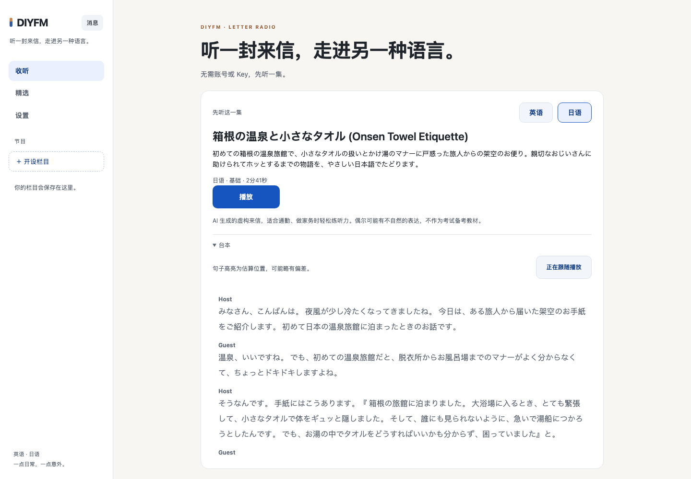
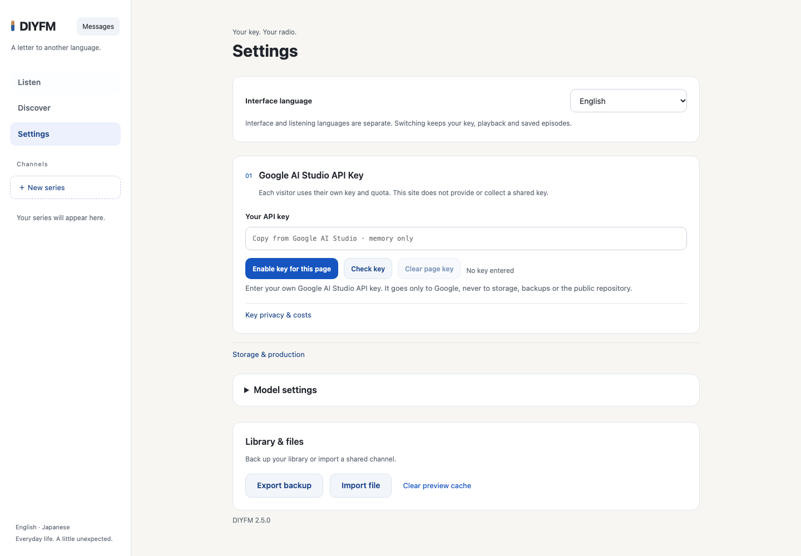
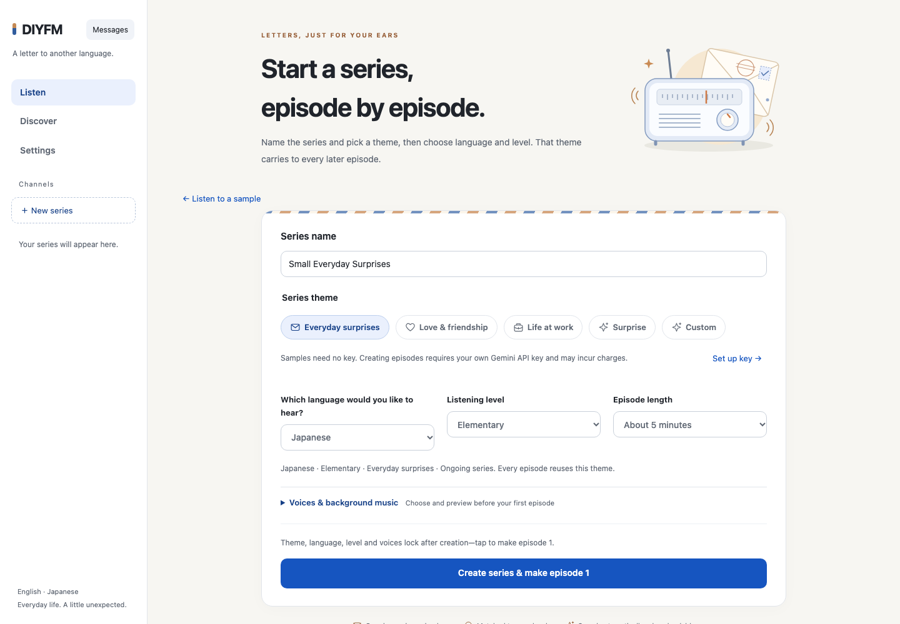
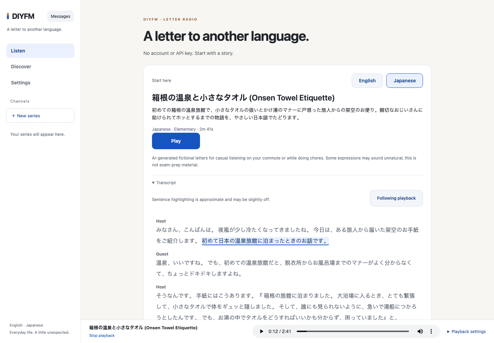
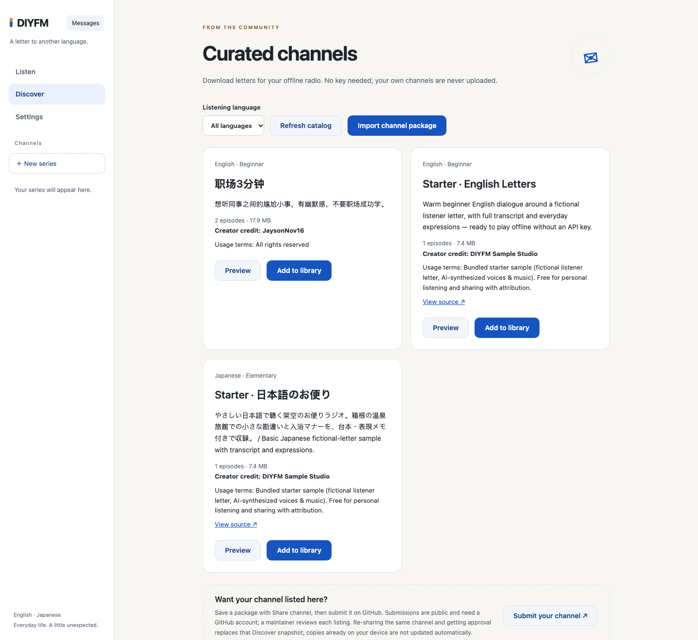

# DIYFM · 来信语言电台

[English](README.md) · [日本語](README.ja.md) · [中文](README.zh-CN.md)

**听一封来信，走进另一种语言。** 两位主持围绕虚构听众来信，聊生活趣事、友情和小误会。选 **英语或日语**，通勤、做家务时轻松听；想换口味时，再开设自己的主题栏目。

**[直接试听：无需账号和 Key](https://jayson-sheyue.github.io/DIYFM/) · [下载 Mac / Android 客户端](https://github.com/jayson-sheyue/DIYFM/releases/latest)**



*配图来自 2.5.0 网页版，使用公开样例。首页展示中文界面，后续操作图使用默认英文界面；可在设置切换中／英／日语。界面语言与收听语言独立。[版本更新说明](https://github.com/jayson-sheyue/DIYFM/releases)。*

**2.5.1** 修复新版 TTS 把表演指示念出来的问题，并为 Web、macOS 和 Android 增加模型预设与自定义 ID。

## 快速开始：先听一集

| 你想做什么 | 从哪里开始 | 需要 API Key 吗？ |
| --- | --- | --- |
| 先体验一集成片 | 首页选择英语／日语 → **播放** | 不需要 |
| 把精选频道保存到本地 | **精选 → 加入本地** | 不需要 |
| 制作自己的主题节目 | 在 **设置** 启用 Key，再 **开设栏目** | 需要自己的 Gemini Key，调用可能计费 |

1. [打开 DIYFM](https://jayson-sheyue.github.io/DIYFM/)，或者安装下方的客户端。
2. 在首页选 **英语** 或 **日语**，点击 **播放**，不用注册或先填写设置。
3. 想边听边看，就阅读默认展开的台本；底部播放器的 **播放设置** 可以调倍速。句子会按估算位置高亮。
4. 想把样例留在节目库里，到 **精选** 找到对应频道，点 **加入本地**。再次打开时会恢复上次选中的已保存频道。

首页只加载所选语言的样例。网页第一次载入需要联网；Mac、Android 内置样例，可离线试听。应用能打开时，已保存成片可以离线收听。不要求答题、开麦、录音、跟读或打卡。

## 制作自己的节目

### 1. 先启用自己的 Key



1. 从 [Google AI Studio](https://aistudio.google.com/apikey) 获取自己的 Gemini API Key。
2. 打开 **设置 → 你的 API Key**，粘贴后点 **在本页启用 Key**。输入框会清空，页面只显示启用状态。
3. **检查 Key** 是可选步骤：只读取当前文本模型的信息，不验证语音、音乐或所有生成权限。
4. 返回 **收听 → 开设栏目**，或在首页点 **开设自己的栏目**。去设置再回来，已填的草稿会保留。

**样例收听不调用生成模型；制作、首次声线试听和音乐生成使用你的 Key，可能产生费用。** Key 只保留在内存里，刷新或退出后清除；已保存的节目仍在，重播不需要重新填 Key。详见 [Key、隐私与数据说明](docs/security.md)。

### 2. 给栏目起名，再选主题



1. 填 **栏目名称**，例如「周末小事电台」。
2. 选择 **生活趣事、恋爱与友情、职场见闻、随机**，或 **自定义**。自定义时描述想听的故事口味即可，例如：
   > 想听室友之间的小误会，轻松好笑一点，用简单日语。
3. 选 **收听语言、难度、时长**。用中文写愿望不会自动选择日语，收听语言以选项为准。默认基础、约 5 分钟，也可选择约 3／5／10／15 分钟。
4. 第一次制作前，可展开 **声音与底乐**，选择两位主持的声音、底乐风格，或选择无底乐。
5. 点 **开设栏目并制作第一期**，到 **消息** 查看进度。可以切换应用内页面，请保持网页打开；Android 制作时保持应用在前台。
6. 完成后点击 **播放**。以后点 **制作新一期** 就能沿用栏目主题，不必每次再写一个情境。

**开设后栏目设定固定**，包括主题、语言、难度、时长、声音与底乐。想换一套设定，另开栏目即可。图中的表单是演示草稿，没有为配图发起付费制作。

## 边听边看：台本与逐句高亮



- 已保存的单集可展开 **台本与本期信息**，查看台本、重点表达和可用的参考来源；首页样例默认展开台本。
- **句子高亮是估算同步。** 新节目利用实际语音段落时长估算段内句子，旧节目和样例按整集时长估算，可能略有偏差。
- 手动滚动或选词时，会暂停自动跟随；点击 **回到当前句** 恢复。暂停播放保留高亮，拖动进度会更新位置。
- **播放设置** 可调倍速，选择 **单曲循环** 或 **频道内连播**。连播按列表顺序播放已完成的节目，最后一集后回到第一集；样例和声音／底乐试听只播放一次。
- 成片保留已有底乐混音；下载 MP3 不调用生成模型。

节目使用 AI 生成的虚构来信与合成声音，适合日常泛听。日语依靠模型审稿和最多一次自纠错，没有逐篇人工校对。表达、发音可能有不自然之处，不作为考试备考教材，也不把听过的表达算作已经掌握。

## 保存、发现与分享



| 你想做什么 | 操作入口 | 得到什么 |
| --- | --- | --- |
| 留一份音频文件 | 单集 → **下载 MP3** | 已有成片音频，包含原有 BGM 混音 |
| 收听精选频道 | **精选 → 预览／加入本地** | 本地频道副本，不需要 Key 或账号 |
| 分享选中的成片 | **频道管理 → 分享频道** | 含台本、音频和公开署名的频道 ZIP |
| 打开朋友分享的频道 | **设置 → 导入文件** | 先预览 ZIP，再确认加入本地 |
| 备份整个节目库 | **设置 → 导出备份** | 频道、台本、音频、普通设置和制作中间成果，不含 Key |
| 换浏览器或设备 | 先导出备份，再到另一端导入 | 合并到目标节目库，不自动云同步 |

公开分享请使用 **频道包**：整库备份可能包含私人愿望和制作材料。两种导出都不含 API Key。已加入本地的精选快照不会自动更新；可选的 **投稿你的频道** 会打开公开 GitHub 表单，需要 GitHub 账号。详见 [分享、署名与精选指南](docs/sharing.md)。

## 安装 Mac 或 Android 客户端

| 版本 | 怎么开始 | 运行要求 |
| --- | --- | --- |
| 网页版 | 用现代浏览器 [打开 DIYFM](https://jayson-sheyue.github.io/DIYFM/) | 首次载入样例需要联网，不用装开发工具 |
| Mac | [下载最新 Universal DMG 或 ZIP](https://github.com/jayson-sheyue/DIYFM/releases/latest)，把 **DIYFM.app** 拖到「应用程序」后打开 | macOS 13+，Apple Silicon 或 Intel |
| Android | [下载最新 APK](https://github.com/jayson-sheyue/DIYFM/releases/latest)，使用系统安装器安装 | Android 8+，较新的 System WebView |

Mac 目前采用本地签名，尚未完成 Apple 公证，下载后可能被系统拦截；Apple Silicon 已实测，Intel 实机未验证。更新 Mac 前先退出应用；Android 使用新版覆盖安装，以保留数据。**设置** 显示当前版本，客户端的更新入口会打开浏览器下载，不会自动安装。详见 [客户端安装、存储和更新说明](docs/clients.md)。

## 界面语言、存储与常见问题

- **怎么切换中文？** 在 **Settings → Interface language** 选择 **中文**；首次默认英语，手动选择会记住。切换界面不翻译已有节目，也不改变收听语言。
- **没有 Key 能用吗？** 可以听首页样例或从精选加入频道。制作、未缓存的声线和音乐试听才需要 Key。
- **刷新后 Key 怎么没了？** 这是预期行为。新制作前重新启用即可，已保存音频仍能播放。
- **制作失败了怎么办？** 到 **消息** 查看详情并重试，兼容的已完成阶段会尽量复用，其余调用仍可能计费。仅底乐失败时会保留纯人声成片。
- **节目去哪儿了？** 不同浏览器、设备和客户端的节目库独立；清理站点／应用数据或卸载可能移除节目。换设备或清理前先备份；只有 MP3 不能还原整个节目库。
- **怎么删除？** 单集的 **···** 菜单可删除本集，**频道管理** 可删除整个频道。删除会确认且无法撤销，需要时先导出备份。

### 模型设置

高级选项在 **设置 → 模型设置**，第一次使用保持默认值即可。

| 功能                   | 默认模型                       | 接口                                               |
| ---------------------- | ------------------------------ | -------------------------------------------------- |
| 策划、核查、创作与审稿 | `gemini-3.8-flash`             | Gemini `generateContent`，核查时使用 Google Search |
| 双人语音与声线试听     | `gemini-3.8-flash-tts` | Gemini Interactions，独立语音元数据                  |
| 约 30 秒器乐底乐       | `lyria-3-clip-preview`         | Gemini Interactions，`store: false`                |

文本、语音与音乐均提供预设列表，也可直接填写自定义模型 ID。预设依据官方目录（核对于 2026-11-27），不保证当前账户可用；Preview 模型可能变更或停用。已保存的 ID 会保留，只有手工更改或点击 **恢复模型默认** 才会改变。语音默认改为 `gemini-3.8-flash-tts`，另列出 `gemini-3.8-flash-lite-tts` 和旧版 `gemini-3.1-flash-tts-preview`。新版 TTS 的正文只含台词，表演指导放入 `speech_metadata.style`，显式请求 24 kHz PCM；旧 Preview ID 保留原 `generateContent` 请求格式。自定义语音 ID 使用当前 Interactions TTS 契约，必须支持该接口；普通文本模型不能代替 TTS。本次请求格式更新不会复用旧试听或失败任务中的旧配音片段；已有完整节目仍保留，不会自动修复。参见[官方语音文档](https://ai.google.dev/gemini-api/docs/speech-generation)和[迁移说明](https://docs.cloud.google.com/gemini-enterprise-agent-platform/models/text-to-speech/migration-guide)。

模型 ID 可以手工修改；是否可用取决于你的 Key、地区、计费和模型能力，不会偷偷换模型。旧版的 Vertex `lyria-002` 不适用于 AI Studio 接口；可填写 Developer API 支持的音乐模型，例如 `lyria-3.5`，但时长与费用可能不同。底乐失败会保留纯人声成片，并明确提示；内容或语音失败不会伪装成完整节目。


## 在本机运行静态版

需要现代浏览器、Node.js 22+（用于安装、检查和构建）；提供静态文件的 HTTP 服务可以任选，不需要 ADC、GCP 项目 ID、Python 后端或部署共享 Key。

```bash
git clone https://github.com/jayson-sheyue/DIYFM.git
cd DIYFM
npm ci --ignore-scripts
npm run vendor
npm test
npm run build

# 任选一个静态 HTTP 服务。例如系统已安装 Python 时：
python3 -m http.server 5055 --directory dist
```

打开 `http://localhost:5055/`。不要双击 `index.html` 以 `file://` 打开；ES modules、IndexedDB、Worker 等需要正常的网页来源。若 5055 已被占用，可改用其他端口。

### 旧版本机 Python 节目库

原 Flask / Vertex 代码为旧库兼容保留，主静态应用不使用其 ADC 生成接口。原有 `data/` 不会被迁移脚本删除或加入 Git。

已有旧版环境可运行原 `app.py`，首页跳转到 `/static/index.html`。仅在这个明确的本机路径下，新页面会尝试将旧库的频道、台本和成片复制到本浏览器；不会调用 Google 或更改旧文件。请先保留 `data/` 副本；若读取失败，原库仍在。

也可以将旧版导出的 ZIP 在新站点 **导入备份**。迁移不会复制 ADC 凭据，也不会把旧 Vertex 设置强行当作 Developer API 设置。迁移后的未完成记录可以回查；跨版本备份导入不保证复用所有旧中间阶段。

## 发布到 GitHub Pages

仓库包含 `.github/workflows/pages.yml`：对 PR 做检查，向 `main` 推送后构建 `dist/` 并发布。

1. 在自己的 GitHub 账户创建公开仓库并推送源码。
2. Repository **Settings → Pages → Build and deployment → Source** 选择 **GitHub Actions**。
3. 运行工作流或推送到 `main`，等待 `Check and deploy DIYFM` 成功。
4. 访问 `https://<你的账户>.github.io/<仓库名>/`。资源使用相对路径，支持项目子路径。

**不需要设置任何 Gemini Key 仓库 Secret。** 不要在 Actions 环境变量、构建参数或网页配置里注入共享 Key；这会把 Key 暴露到公开站点。需要由站长承担调用费用时，应另做带访问控制与用量限制的服务端，不能靠 GitHub Pages 隐藏 Key。

## 实现结构

```text
static/
  app.js / app.css / index.html    界面、播放、消息和管理
  app-entry.mjs                   静态版启动与本机迁移边界
  i18n.mjs / messages.mjs          三语界面、语言偏好与文案
  browser-api.mjs / library.mjs    任务、IndexedDB、备份与兼容接口
  harness.mjs / editorial.mjs      固定编排规则与动态策划 / 审稿
  gemini.mjs                      内存 Key、固定 Google API 适配
  audio.mjs / mp3-worker.js        音频解码、混音、WAV 与 MP3
  vendor/                        自托管的编码 / ZIP 库及许可证
scripts/build-pages.mjs            静态产物与凭据模式检查
tests/                            受控接口、存储、媒体和时序回归
```

程序不会将“出现过某个表达”标记为用户已掌握，也不保证教学效果、模型事实或发音永远正确。3 / 5 / 10 / 15 分钟是编排目标，实际以成片时长为准。搜索失败不会伪造来源；内容审稿最多修订一次。语音按批处理，降低一次失败丢失全部进度的代价。

## 开发检查与已知边界

```bash
npm test            # 静态版规则、凭据边界、IndexedDB、备份、播放竞态
npm run build       # 生成 dist 并检查已知凭据模式
./scripts/check.sh  # 另含旧 Python 路径回归；需要原 Python 依赖
```

自动检查不等于真实 Google 账户联调；实际验证环境、服务调用和未验证项统一记录在 [docs/testing.md](docs/testing.md)。模型是否开放、地区、付费层级、配额及服务生命周期以 Google 为准；Key 检查成功不保证所有模型和 Google Search 可用。不同浏览器的下载、后台执行、存储额度和媒体行为也可能不同。

## 开源协议

DIYFM 自身源码以 [MIT 协议](LICENSE) 发布。第三方组件沿用各自许可证，见 [THIRD_PARTY.md](THIRD_PARTY.md)。目录中的频道包按各自署名里写明的使用条款提供。
